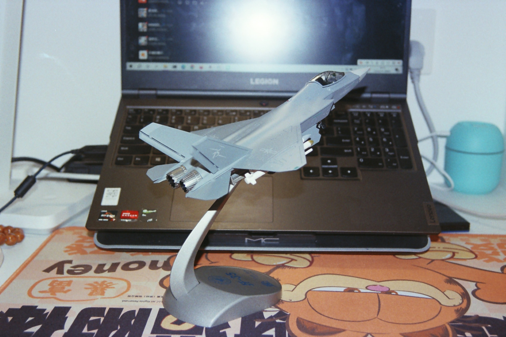
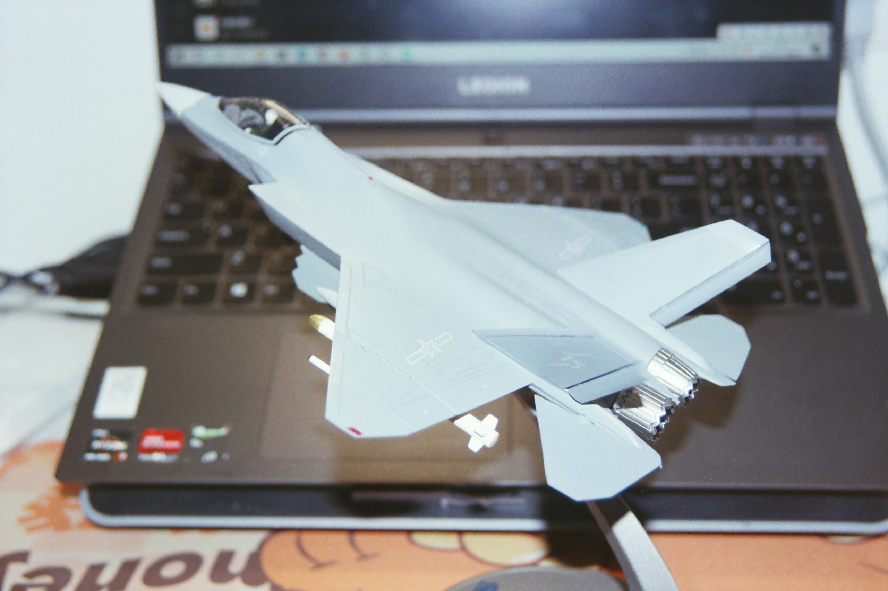
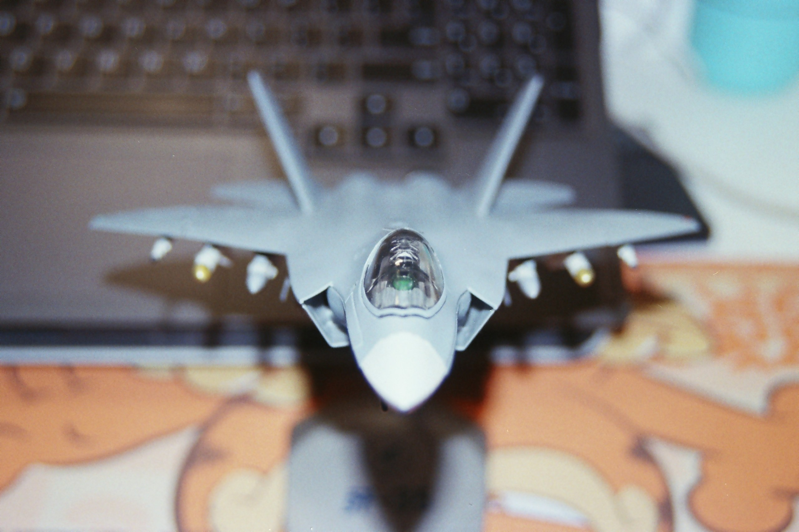
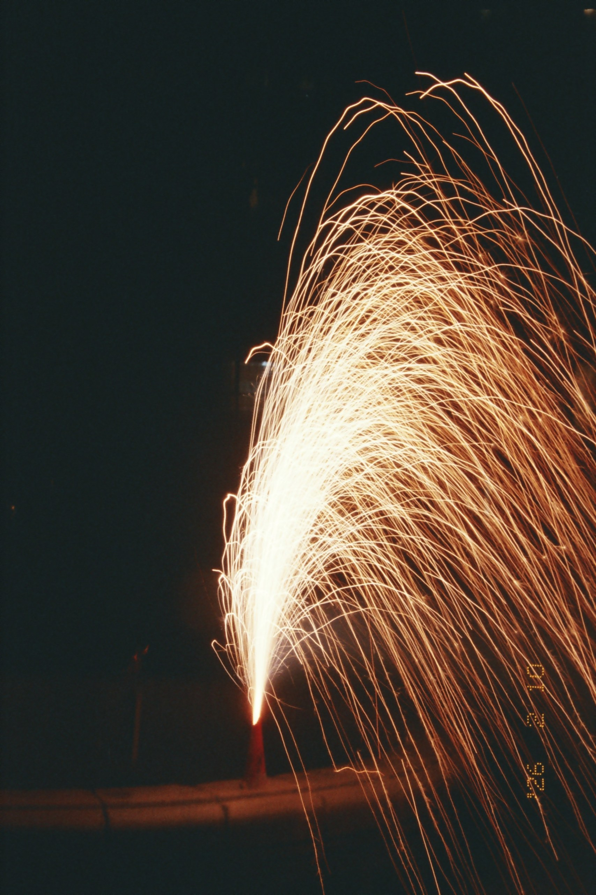
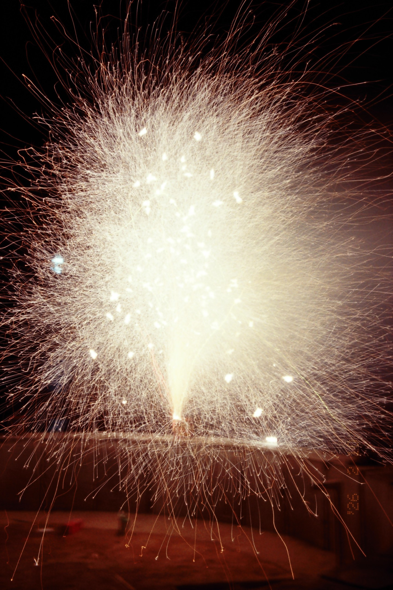
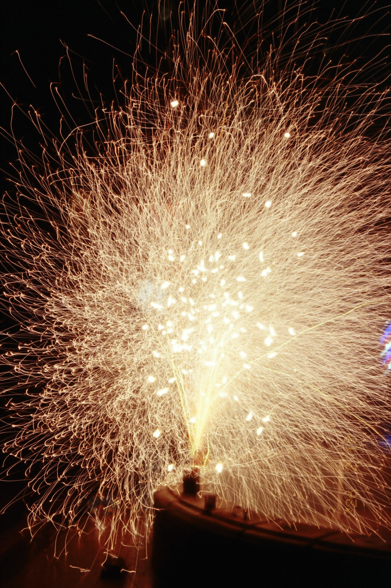
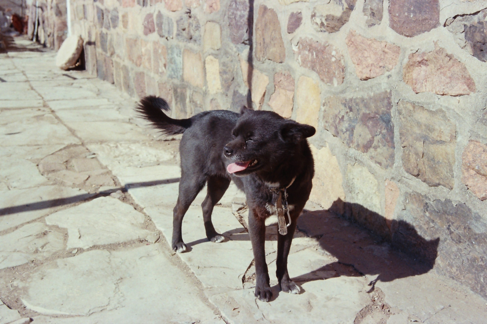
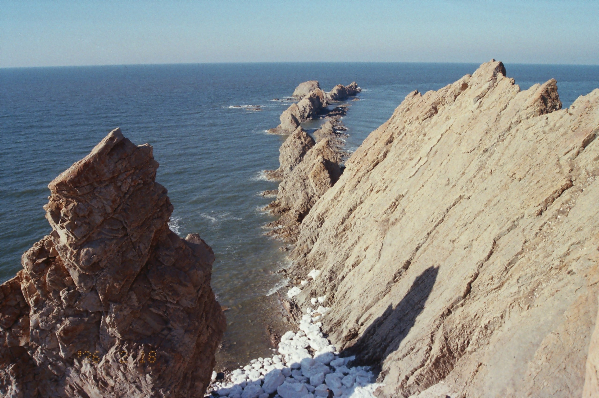
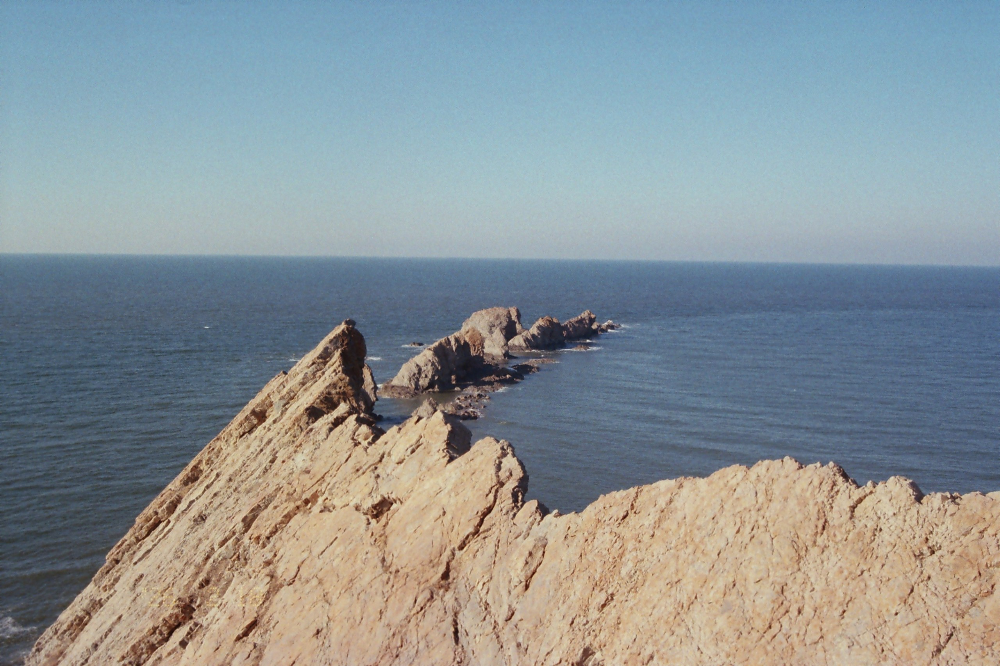

这也算是我第一卷成功的胶卷，巨星400的色彩确实很润，非常耐看。
> 📋 **这一卷的家伙事儿**
>
> - 📷 **机身**　美能达 α3
> - 🔭 **镜头**　美能达 28-80mm f/3.5-5.6D
> - 🎞️ **胶卷**　巨星400
> - 🖨️ **扫描**　柯尼卡美能达 DS-2000

## 📸 成片
|  |  |  |
| :---: | :---: | :---: |
|  |  |  |
|  |  |  |