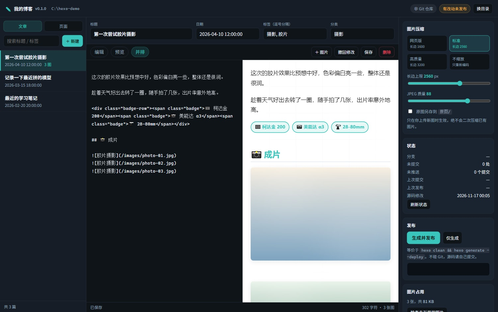

这个博客是 Hexo + GitHub Pages，写久了就攒下两个烦人的地方。

一个是**图片**。相机原图随手就是七八 MB，一次旅行回来几十张，往仓库里一扔，图床没上、压缩工具又懒得单独跑，最后页面加载慢得自己都不想看。

另一个是**流程太碎**。新建文章、写 Markdown、把图挪进 `source/images`、改路径、`hexo clean`、`hexo generate --deploy`、再来 `git push` —— 步骤不算多，但每次都容易漏。尤其是「源码提交了、网站没生成」或者反过来，我自己就干过好几次。

所以这周干脆写了个小工具，把这两件事收进一个界面里。

<div class="badge-row"><span class="badge">💻 本地运行</span><span class="badge">🔒 不联网</span><span class="badge">🖼️ 图片自动压缩</span><span class="badge">🚀 一键发布</span><span class="badge">📦 已开源</span></div>

## 🧰 它长什么样



左边是文章和页面列表，中间写 Markdown、右边调压缩参数和点发布，中间那栏可以切成「并排」实时看效果。

说白了就是个编辑器，但有三点和我以前用的工具不一样：

- **图片直接拖进去**，它当场压缩、存好、把 `` 插到光标位置，一步不用管
- **内嵌预览用的是我自己主题的 CSS**，所见基本就是所得
- **顶栏一直告诉我源码和线上是否一致**，不用再自己回忆「我上次发布了吗」

## 🖼️ 图片这一块，坑比想象中多

最开始我想得很简单：所有图按长边 2560 压成 JPEG 就完事。真正做下来发现有几个必须处理的情况。

**第一，绝对不能再压一次。** 有损压缩是有代价的，同一张图压两遍画质会明显糊掉。所以工具的规则是：**只压你新拖进来的图，已有的文件一个都不碰**。听起来是废话，但很多工具就是在这上面出问题的。

**第二，透明通道不能无脑转 JPEG。** PNG 带透明的话转 JPEG 背景会变黑，所以带 alpha 的一律保留 PNG，其余才转。

**第三，BMP 和 TIFF。** 我玩胶片，扫描店出来经常是 `.bmp` 或 `.tif`。TIFF 好办，`sharp` 原生支持；**BMP 就不行**，`sharp` 会直接报 `unsupported image format`。最后我照着 BMP 格式规范自己写了个极简解码器，支持未压缩的 8/24/32 位，解成原始像素再交给 `sharp` 转 JPEG。写完拿 Pillow 解同一张图逐像素对比过，最大像素差是 0。

**第四，动图别压成一帧。** GIF / WebP 如果是多帧动画，转 JPEG 就等于把动画毁了，所以这类直接原样保留，不压。

实测数据放在这儿，你自己感受下差距：

| 原图 | 处理后 | 比例 |
| :--- | :--- | :--- |
| 相机原图 5148×3784，7.2 MB | 354 KB（长边 2560 / q88） | 4.8% |
| 同一张，长边 1600 / q82 | 123 KB | 1.7% |
| 胶片扫描 BMP 3.03 MB | 236 KB | 7.6% |

整个博客的图片我统计过：**570.9 MB → 53.8 MB**，剩 9.4%。而且这是在长边 2560 的前提下，点开看细节也不糊。

## 🚀 发布为什么是「两步」

这个结构值得单独说，因为它一开始我也理解错过。

Hexo 部署到 GitHub Pages，常见做法是**一个仓库两个分支**：

> **`source`** 分支放源文件 —— `.md`、图片、主题、配置，这是你自己 `git push` 的
>
> **`main`** 分支放生成的 HTML/CSS/JS —— 由 `hexo generate --deploy` 自动推上去，Pages 从这儿发布

所以一次完整发布是两件事：

```bash
# ① 生成并推送产物 → 网站变了
hexo clean && hexo generate --deploy

# ② 提交源码 → 备份，别人才能看到你的 markdown
git add -A && git commit -m "..." && git push origin source
```

**只做①**：网站更新了，但你的文章只在本地，硬盘一坏就全没了。
**只做②**：源码备份了，但网站还是旧的。

工具只做①，②永远留给你自己敲。这不是偷懒 —— 自动提交会把提交历史搅乱，而且一次提交包含哪些改动，本来就该由人来决定。工具能做的是在顶栏用红字提醒你「N 处改动未提交」，别忘就行。

## 🧩 中途砍掉的功能

这类工具很容易越写越大，我砍掉了三个看着不错的东西：

**图床。** 一开始觉得该做，后来想明白：我图片总量压完才 54 MB，直接进仓库完全够用，图床反而多一个要维护、可能挂掉、还会产生外链依赖的环节。**没有需求就不要造轮子。**

**社交平台的分享按钮。** 本来想加微信/QQ 分享，查下来发现：微信的 JS-SDK 只在微信内置浏览器里生效，还需要认证服务号和服务器签名；应用外只能调 OpenSDK，那是原生 App 的事。为一篇博客搭这套太夸张了。最后全部统一成「复制链接」，一句话提示，干干净净。

**在界面里改配置文件。** 这个做了一半放弃了。那两份 YAML 全是注释，用常规方法重写会把注释冲掉，得按行精准改写才安全；而我的仓库是 CRLF 换行，第一版正则遇到行尾的 `\r` 会静默匹配失败 —— 表现就是「点了保存但没生效」，这种 bug 最难查。想想还是算了：那几个字段一年改一次，直接开文本编辑器更快。

## 🐛 几个真折腾了半天的 bug

写的过程里踩的坑，记下来给自己也给别人：

**1. 多选图片只传了第一张。** `e.target.files` 拿到的是**实时的 FileList**，我在异步上传开始后顺手写了句 `input.value = ''` 想把选择清空，结果 FileList 跟着一起空了，循环跑到第二轮时长度已经是 0。修法：进函数第一件事先 `slice` 成真数组。

**2. 徽章全竖着堆成一列。** 在 Markdown 里写 `<div>` 包裹的内容，只要中间有一个空行，HTML 块就在那儿被截断了，剩下的 `<span>` 会被当成普通段落，每行之间插 `<br>`。所以这种自定义块必须写成**一整行**。

**3. YAML 里的日期悄悄差了 8 小时。** `js-yaml` 默认会把 `2026-04-10 12:00:00` 当成 UTC 解析，再按本地时区格式化就成了 20:00。改用 `JSON_SCHEMA` 让它当字符串处理后正常。

**4. 主题只给 `.post-content` 写了样式。** 我的关于页容器叫 `.about-content`，所以关于页里的表格在很长一段时间里是**没有边框的裸表**，我一直以为是主题就这么设计的，直到重做关于页才发现。

**5. 用 PowerShell 批量改 UTF-8 文件要小心。** 我有一次用 `Get-Content -Raw` 读 `_config.yml` 再写回去，Windows PowerShell 5.1 默认按 GBK 解码 —— 中文全被二次编码毁掉，构建直接失败。这种操作用专门的编辑工具，或者显式指定 `-Encoding UTF8`。

## 📦 开源了

东西整理干净后放到 GitHub 上了，MIT 协议，随便用：

> **<https://github.com/navybunny/hexo-post-studio>**

```bash
# 直接从 GitHub 跑，不用装
npx --yes github:navybunny/hexo-post-studio

# 或者克隆下来
git clone https://github.com/navybunny/hexo-post-studio.git
cd hexo-post-studio && npm install && npm start
```

它的定位很窄：**只服务「Hexo + 本地图片 + GitHub Pages」这一种组合**，不打算变成通用博客平台。如果你的情况正好一样，应该能省点事；不一样的话，那几段图片压缩和发布流程的代码也可以单独拆出来用。

---

这次折腾下来最深的体会是：**自己用的工具，最好的功能往往是「少做一点」。**

不自动提交、不上图床、不搞分享生态、不在界面里改配置 —— 每一个「不做」的地方，都少了一处以后会出问题的地方。
