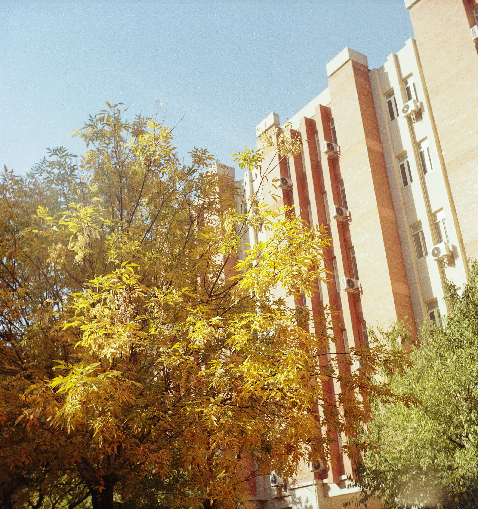
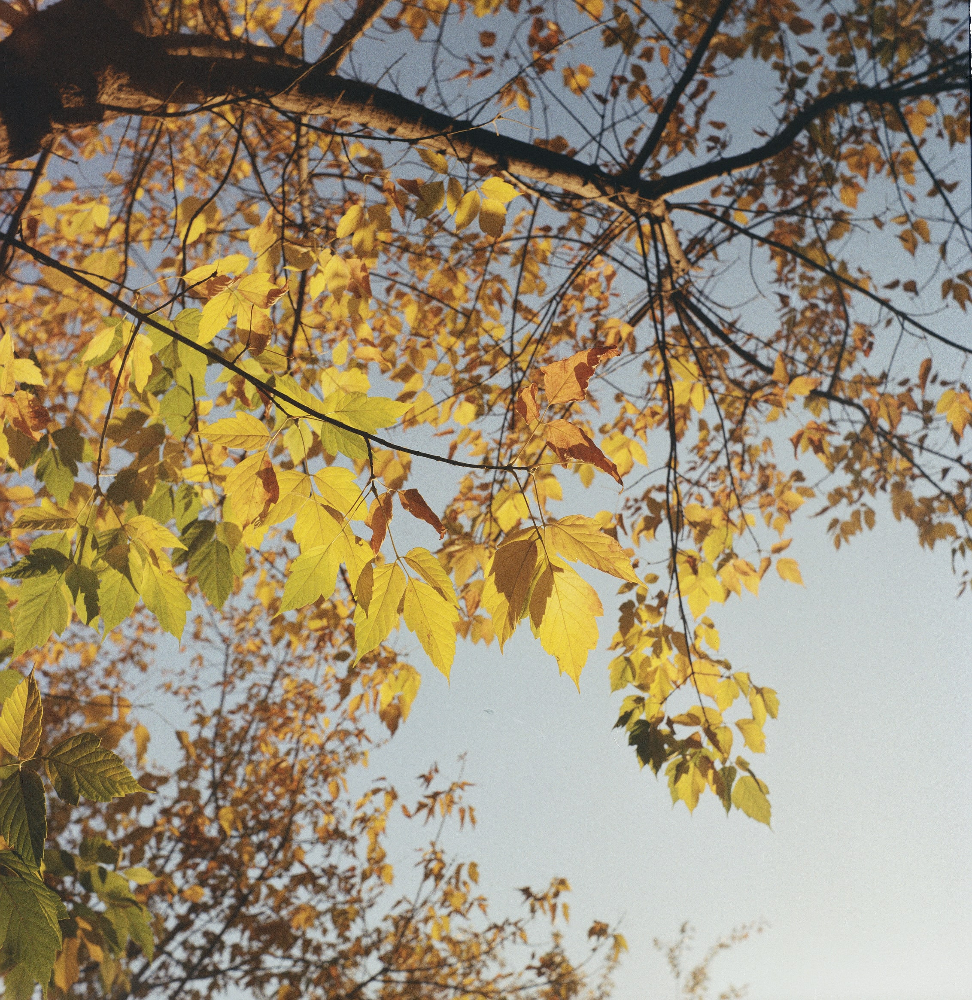
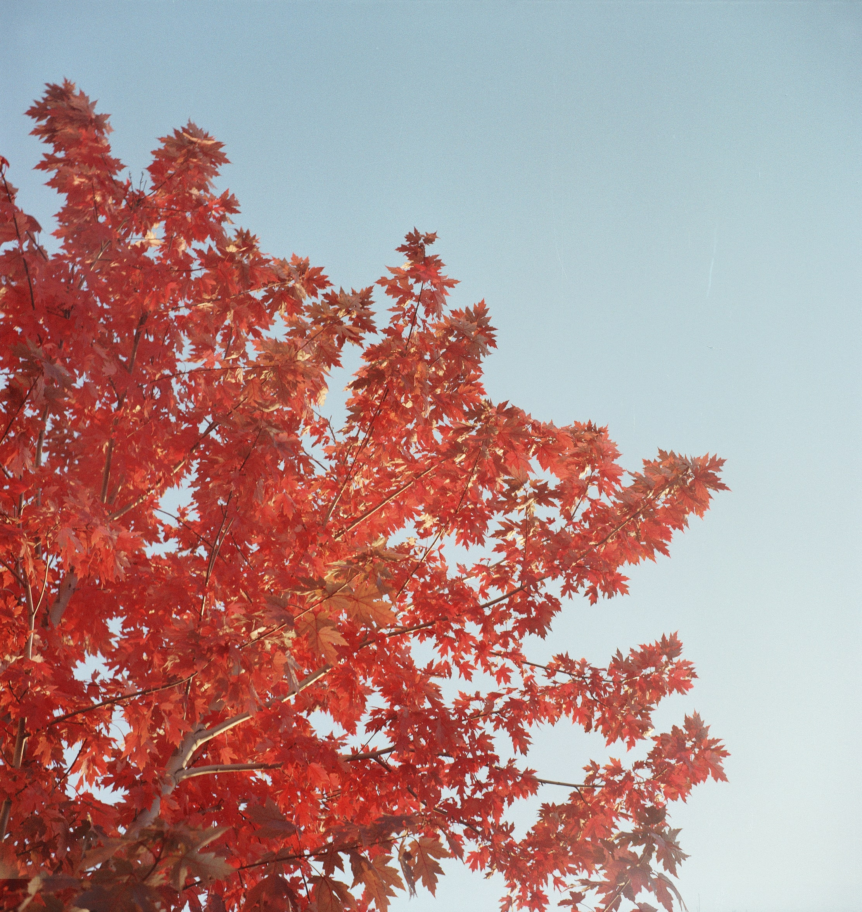
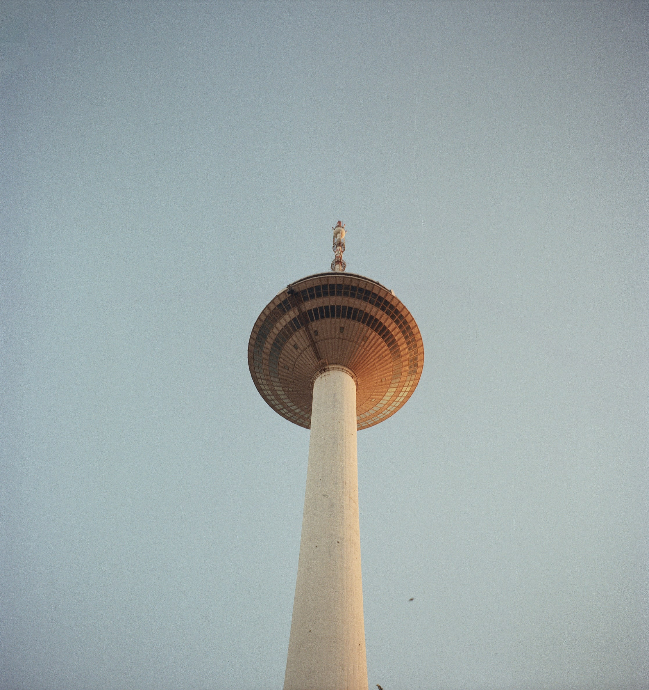
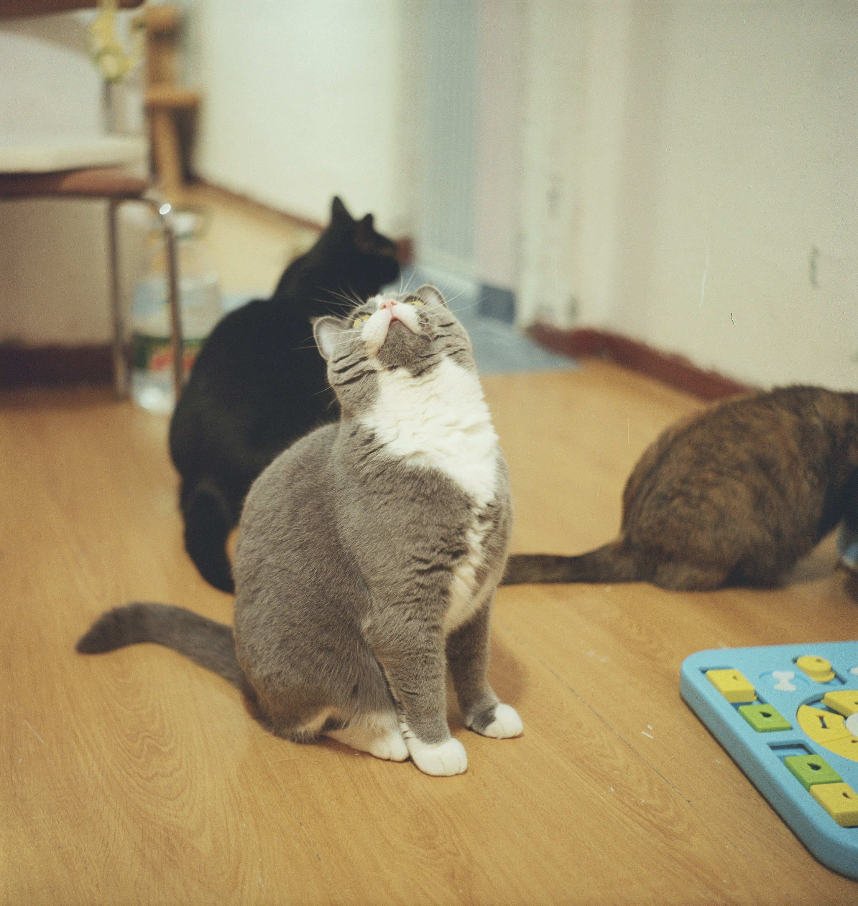
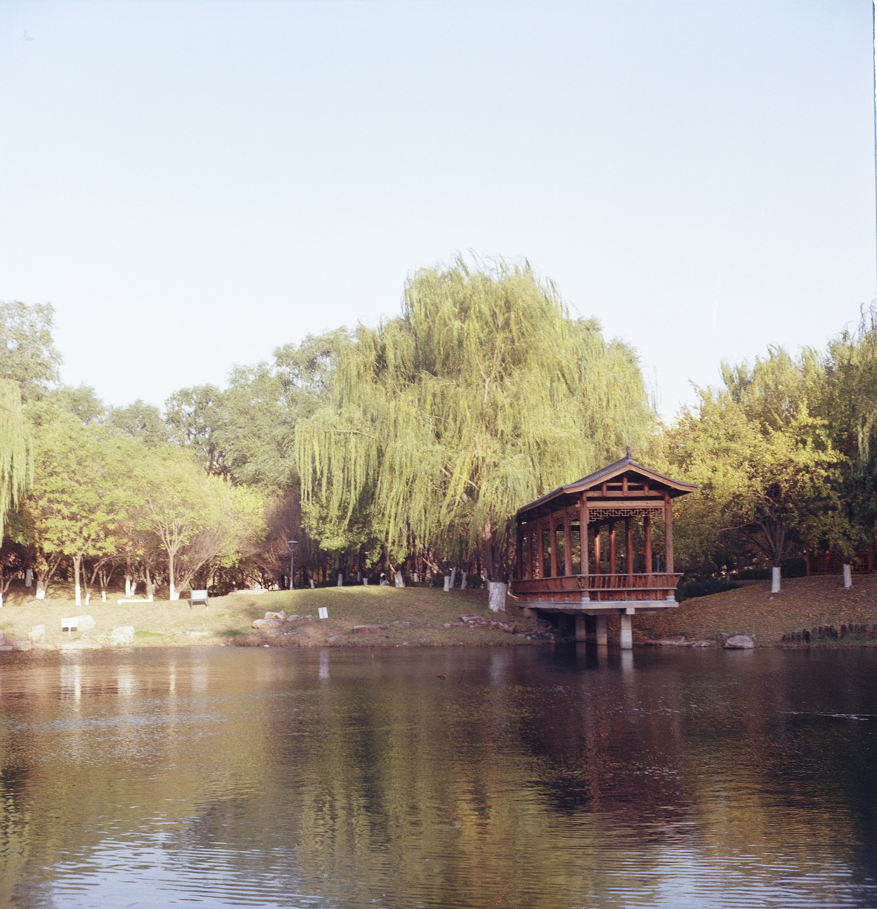

第一次尝试120胶卷，总体还算成功。
那两张炫光纯是自己构图问题，一个是不能对着光源拍，还有就是老款柯克结构镜头的抗眩光能力和画质本就一般般。

> 📋 **这一卷的家伙事儿**
>
> - 📷 **机身**　海鸥4A
> - 🔭 **镜头**　海鸥原厂柯克镜头75mm f3.5
> - 🎞️ **胶卷**　柯达金200
> - 🖨️ **扫描**　柯尼卡美能达 DS-2000

---

## 📸 成片

